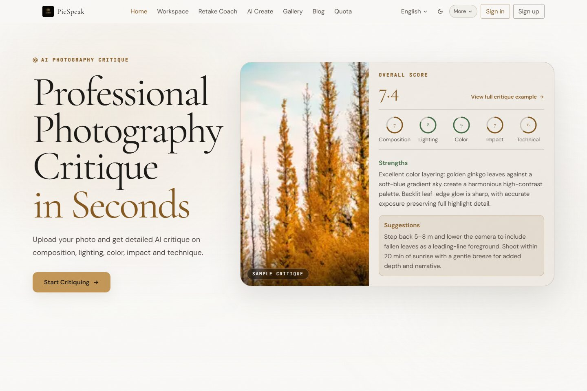
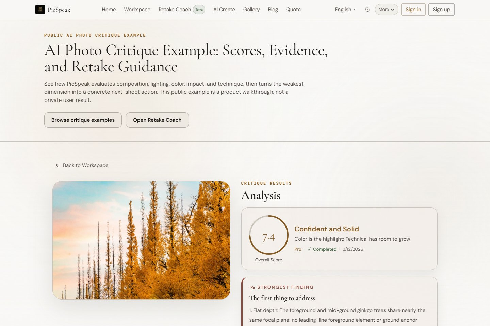
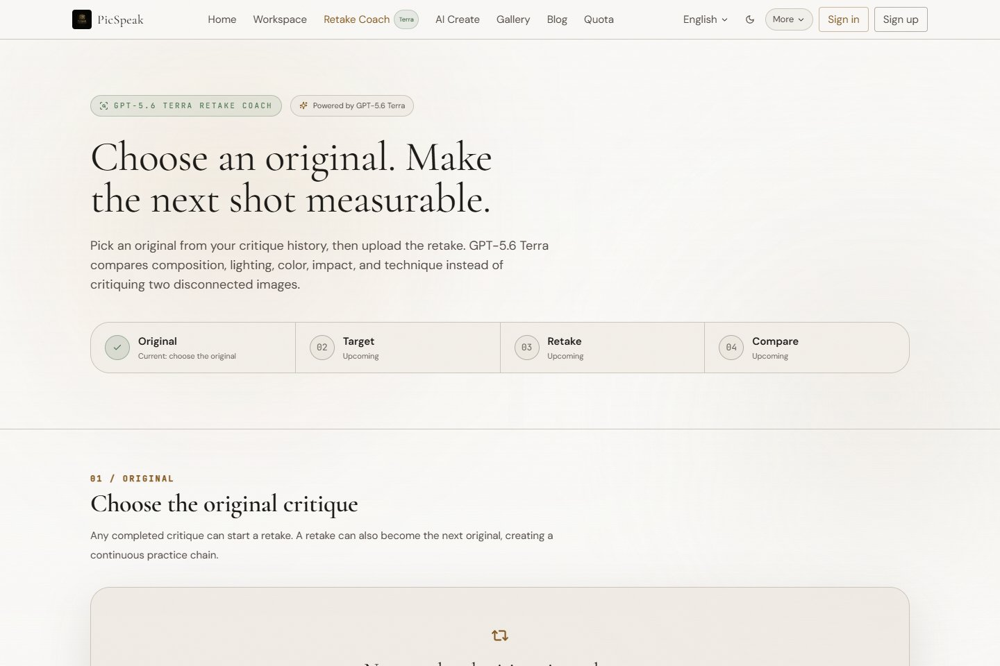
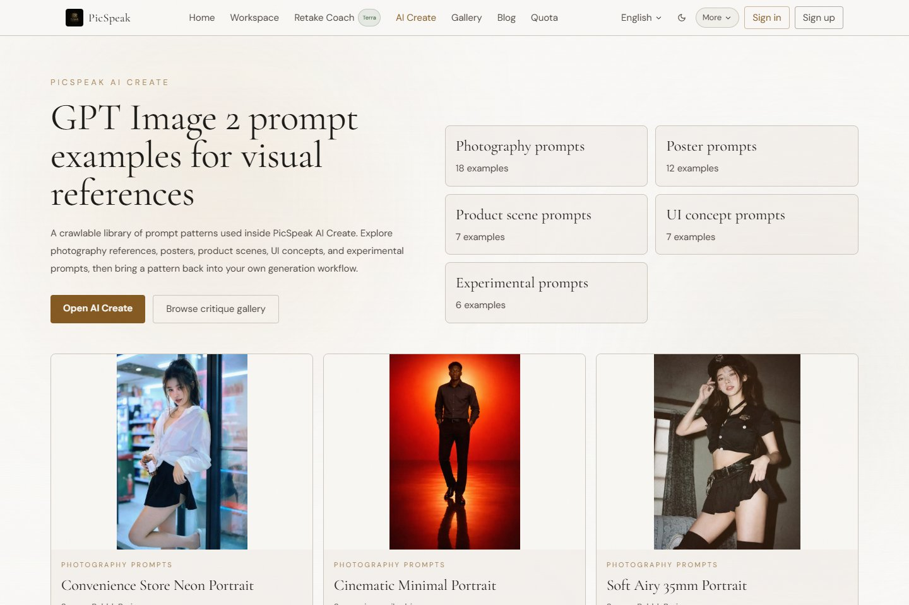
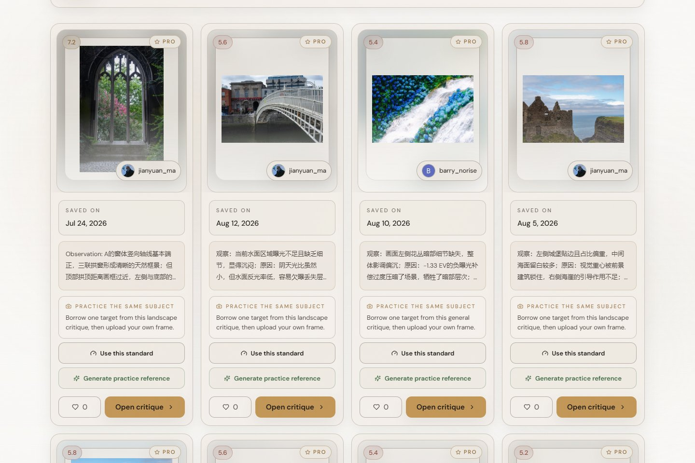

<div align="center">


# PicSpeak

**AI photography critique that turns feedback into the next shot.**

[](https://github.com/AsaZhou923/picspeak/actions/workflows/ci.yml)
[](LICENSE)
[](https://nextjs.org/)
[](https://fastapi.tiangolo.com/)
[](https://www.postgresql.org/)

[**Live demo**](https://www.picspeak.art/en) · [Example critique](https://www.picspeak.art/reviews/rev_8424d4fbde054759) · [Retake Coach](https://www.picspeak.art/retake) · [Prompt library](https://www.picspeak.art/generate/prompts) · [Gallery](https://www.picspeak.art/gallery)

English | [简体中文](README.zh-CN.md)



</div>

## ✨ Features

- **📸 Five-dimension critique.** Scores composition, lighting, color, impact, and technique, and points to the visible evidence behind each score. Flash (GPT-6 Sol) is fast; Pro (GPT-6.1 Sol) goes deeper.
- **🔁 Retake Coach.** Upload a retake and both photos are scored together on one rubric. The server calculates every delta and keeps a progress chain for each source photo.
- **🎯 Next-shoot actions.** The weakest point becomes a concrete retake target with an observable success check.
- **🎨 AI Create.** GPT Image 2 references for composition, lighting, and color, linked to your critique, plus 50 public prompt examples.
- **🌏 Built to share.** Public gallery, Lens Notes, and full English, Chinese, and Japanese UI. Guests can try it without signing up.

<table>
  <tr>
    <td width="50%"></td>
    <td width="50%"></td>
  </tr>
  <tr>
    <td align="center"><b>Critique</b></td>
    <td align="center"><b>Retake Coach</b></td>
  </tr>
  <tr>
    <td></td>
    <td></td>
  </tr>
  <tr>
    <td align="center"><b>Prompt library</b></td>
    <td align="center"><b>Gallery</b></td>
  </tr>
</table>

## 🚀 Quick start

**Requirements:** Python 3.11+, Node.js 20+, PostgreSQL 14+, S3-compatible storage, and an OpenAI API key.

```bash
git clone https://github.com/AsaZhou923/picspeak.git && cd picspeak
cp backend/.env.example backend/.env                 # fill in DATABASE_URL, OBJECT_*, OPENAI_API_KEY
cp frontend/.env.local.example frontend/.env.local   # set NEXT_PUBLIC_API_URL
```

```bash
# Terminal 1: backend at http://localhost:8000
python -m venv .venv && source .venv/bin/activate    # Windows: .venv\Scripts\activate
pip install -r backend/requirements.txt
cd backend && python scripts/ensure_runtime_schema.py && uvicorn app.main:app --reload --port 8000
```

```bash
# Terminal 2: frontend at http://localhost:3000
cd frontend && npm install && npm run dev
```

<details>
<summary><b>Environment variables</b></summary>

<br>

The full list is in [`backend/.env.example`](backend/.env.example).

| Purpose | Variables |
|---|---|
| Required | `DATABASE_URL`, `APP_SECRET`, `OAUTH_JWT_SECRET`, `OBJECT_*`, `OPENAI_API_KEY` |
| Models | `OPENAI_SCORE_MODEL` / `OPENAI_REVIEW_MODEL` (Flash, `gpt-6-sol`), `OPENAI_PRO_MODEL` (Pro, `gpt-6.1-sol`), `RETAKE_ANALYSIS_*` |
| Image generation | `IMAGE_GENERATION_*` |
| Optional | `CLERK_*` (sign-in), `LEMONSQUEEZY_*` (billing), `CLOUD_TASKS_*` (queue), `AI_*` (Qwen-compatible API) |

</details>

<details>
<summary><b>Tests</b></summary>

<br>

```bash
.venv/bin/python -m pytest backend/tests                           # backend
cd frontend && npm run typecheck && npm run lint && npm run test   # frontend
```

</details>

<details>
<summary><b>Deployment</b></summary>

<br>

- **Frontend:** a standard Next.js app ([`vercel.json`](vercel.json) is included), or run `npm run build && npm run start`.
- **Backend:** container image from [`backend/Dockerfile`](backend/Dockerfile), built by [`cloudbuild.yaml`](cloudbuild.yaml). The worker runs inside the API by default. Run `python -m app.worker_main` to split it into its own process.
- **Images** are read through signed URLs and a backend proxy, so the bucket can stay private. Scripts in `backend/scripts/` default to dry-run.

</details>

## 🏗️ Architecture

```text
Next.js 15 ──upload──▶ S3 / R2
    │
    ▼
FastAPI ──▶ async worker ──▶ OpenAI Responses (critique) · GPT Image 2 (create)
    │
    ▼
PostgreSQL: reviews · tasks · billing · progress
```

Auth uses Clerk plus guest sessions, and billing uses Lemon Squeezy. More detail: [system architecture](docs/architecture/系统架构.md) (Chinese) · [design system](DESIGN.md).

<details>
<summary><b>OpenAI Build Week 2026</b></summary>

<br>

PicSpeak existed before Build Week. During the event, the single-photo product became an auditable retake loop: [`b74ddfb`](https://github.com/AsaZhou923/picspeak/commit/b74ddfb88ae32e37965ba8b29f40c9ebcbbf77fc) is the baseline and [`2a626aa`](https://github.com/AsaZhou923/picspeak/commit/2a626aabab30d5cdb45ca0450fdd1ce7a5387b4c) is the core paired comparison. Three rules keep the results honest:

1. Both photos are rescored in the same request, on the same rubric.
2. Python calculates every delta. The model never does the arithmetic.
3. Unrelated or low-confidence pairs never count as improvement.

The event version used GPT-5.6 Terra. The current runtime uses GPT-6 Sol (Flash) and GPT-6.1 Sol (Pro), and every saved result records the model that produced it.

</details>

## 📝 Changelog

The latest entry is [failed critiques no longer use a guest's allowance](docs/changelog/CHANGELOG.md#2026-11-13-failed-critiques-no-charge). See the [full changelog](docs/changelog/CHANGELOG.md) for older entries.

## 🤝 Contributing

Issues and PRs are welcome. Keep changes scoped, add tests for the behavior you change, and keep public demos separate from private user reviews.

## 📄 License

[MIT](LICENSE)
