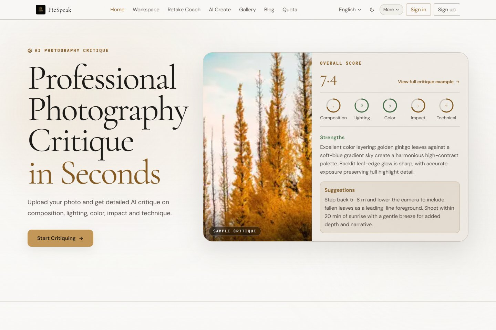
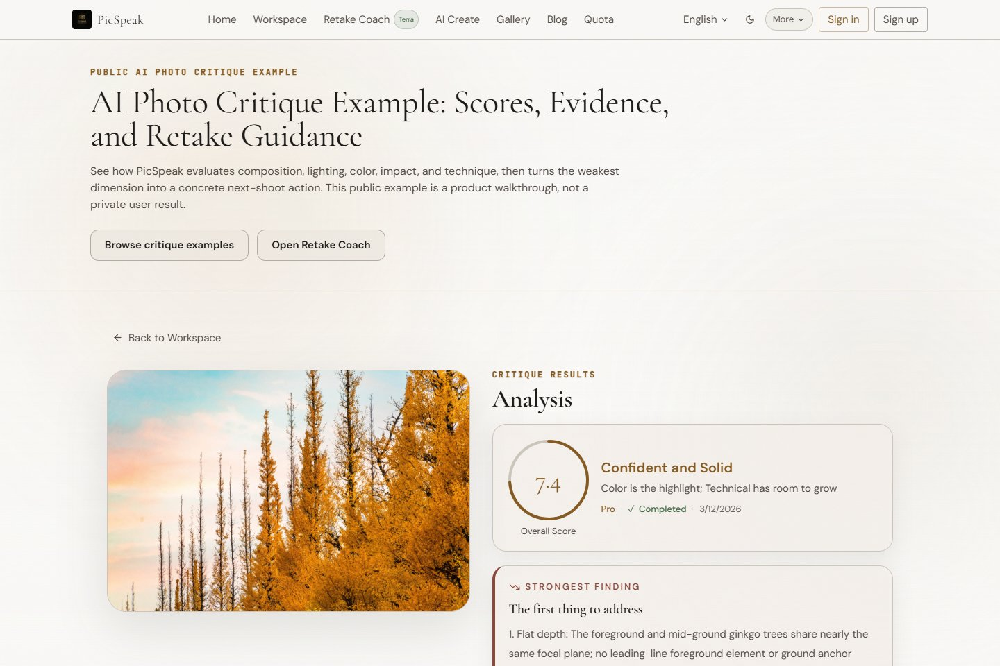
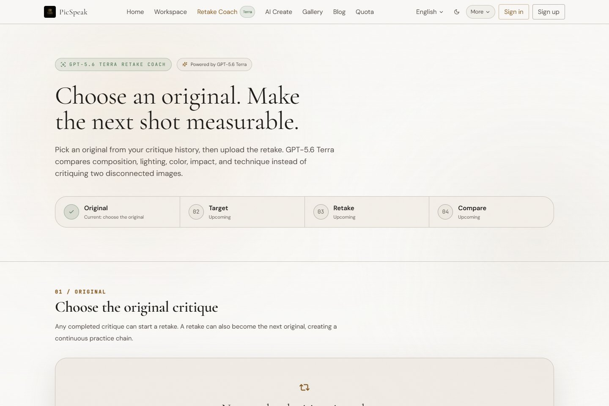
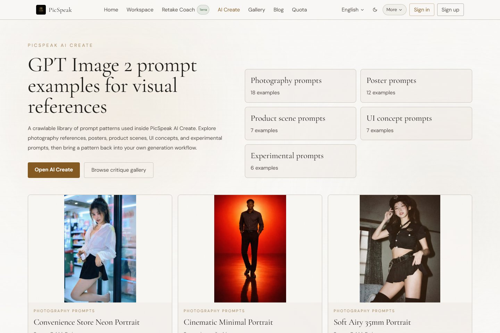
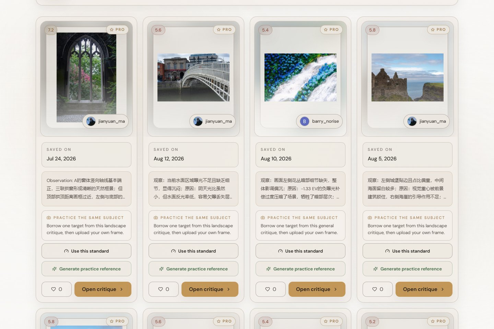

<div align="center">


# PicSpeak

**把摄影点评真正变成下一次拍摄。**

[](https://github.com/AsaZhou923/picspeak/actions/workflows/ci.yml)
[](LICENSE)
[](https://nextjs.org/)
[](https://fastapi.tiangolo.com/)
[](https://www.postgresql.org/)

[**在线体验**](https://www.picspeak.art/zh) · [点评示例](https://www.picspeak.art/reviews/rev_8424d4fbde054759) · [复拍教练](https://www.picspeak.art/retake) · [提示词案例库](https://www.picspeak.art/generate/prompts) · [影像长廊](https://www.picspeak.art/gallery)

[English](README.md) | 简体中文



</div>

## ✨ 功能

- **📸 五维点评：** 从构图、光线、色彩、感染力、技术五个维度评分，并指出每项分数背后的画面证据。Flash（GPT-6 Sol）速度快，Pro（GPT-6.1 Sol）分析更深入。
- **🔁 复拍教练：** 上传复拍后，两张照片按同一把尺一起评分。所有分差由服务端计算，每张来源照片都有自己的进步链。
- **🎯 下一次拍摄：** 最弱项会转成具体的复拍目标，并附上可观察的成功条件。
- **🎨 AI 创作：** 用 GPT Image 2 生成与点评关联的构图、光线、色彩参考图，另有 50 个公开提示词案例。
- **🌏 开放分享：** 公开长廊、镜头手记，界面完整支持中、英、日三语。游客无需注册即可体验。

<table>
  <tr>
    <td width="50%"></td>
    <td width="50%"></td>
  </tr>
  <tr>
    <td align="center"><b>摄影点评</b></td>
    <td align="center"><b>复拍教练</b></td>
  </tr>
  <tr>
    <td></td>
    <td></td>
  </tr>
  <tr>
    <td align="center"><b>提示词案例库</b></td>
    <td align="center"><b>影像长廊</b></td>
  </tr>
</table>

## 🚀 快速开始

**依赖：** Python 3.11+、Node.js 20+、PostgreSQL 14+、S3 兼容存储，以及一个 OpenAI API Key。

```bash
git clone https://github.com/AsaZhou923/picspeak.git && cd picspeak
cp backend/.env.example backend/.env                 # 填写 DATABASE_URL、OBJECT_*、OPENAI_API_KEY
cp frontend/.env.local.example frontend/.env.local   # 设置 NEXT_PUBLIC_API_URL
```

```bash
# 终端 1：后端 http://localhost:8000
python -m venv .venv && source .venv/bin/activate    # Windows：.venv\Scripts\activate
pip install -r backend/requirements.txt
cd backend && python scripts/ensure_runtime_schema.py && uvicorn app.main:app --reload --port 8000
```

```bash
# 终端 2：前端 http://localhost:3000
cd frontend && npm install && npm run dev
```

<details>
<summary><b>环境变量</b></summary>

<br>

完整列表见 [`backend/.env.example`](backend/.env.example)。

| 用途 | 变量 |
|---|---|
| 必填 | `DATABASE_URL`、`APP_SECRET`、`OAUTH_JWT_SECRET`、`OBJECT_*`、`OPENAI_API_KEY` |
| 模型 | `OPENAI_SCORE_MODEL` / `OPENAI_REVIEW_MODEL`（Flash，`gpt-6-sol`）、`OPENAI_PRO_MODEL`（Pro，`gpt-6.1-sol`）、`RETAKE_ANALYSIS_*` |
| 图像生成 | `IMAGE_GENERATION_*` |
| 可选 | `CLERK_*`（登录）、`LEMONSQUEEZY_*`（计费）、`CLOUD_TASKS_*`（队列）、`AI_*`（Qwen 兼容接口） |

</details>

<details>
<summary><b>测试</b></summary>

<br>

```bash
.venv/bin/python -m pytest backend/tests                           # 后端
cd frontend && npm run typecheck && npm run lint && npm run test   # 前端
```

</details>

<details>
<summary><b>部署</b></summary>

<br>

- **前端：** 标准 Next.js 应用，仓库已包含 [`vercel.json`](vercel.json)，也可以运行 `npm run build && npm run start` 自行托管。
- **后端：** 由 [`backend/Dockerfile`](backend/Dockerfile) 构建容器镜像，[`cloudbuild.yaml`](cloudbuild.yaml) 负责构建。worker 默认运行在 API 进程内，运行 `python -m app.worker_main` 可拆成独立进程。
- **图片读取**走签名 URL 和后端代理，bucket 可以保持私有。`backend/scripts/` 中的脚本默认 dry-run。

</details>

## 🏗️ 架构

```text
Next.js 15 ──上传──▶ S3 / R2
    │
    ▼
FastAPI ──▶ 异步 worker ──▶ OpenAI Responses（点评）· GPT Image 2（创作）
    │
    ▼
PostgreSQL：点评 · 任务 · 计费 · 进步记录
```

登录使用 Clerk 和游客会话，计费使用 Lemon Squeezy。更多细节见：[系统架构](docs/architecture/系统架构.md) · [设计系统](DESIGN.md)。

<details>
<summary><b>OpenAI Build Week 2026</b></summary>

<br>

PicSpeak 在 Build Week 之前已经存在。活动期间，单张点评扩展成了可审计的复拍闭环：基线为 [`b74ddfb`](https://github.com/AsaZhou923/picspeak/commit/b74ddfb88ae32e37965ba8b29f40c9ebcbbf77fc)，配对比较的核心实现在 [`2a626aa`](https://github.com/AsaZhou923/picspeak/commit/2a626aabab30d5cdb45ca0450fdd1ce7a5387b4c)。三个原则保证结果可信：

1. 两张照片在同一次请求、同一评分口径下重新打分。
2. 所有分差由 Python 计算，不让模型负责算术。
3. 无关图片或低置信度配对不计入“进步”。

活动版本使用 GPT-5.6 Terra。当前运行时 Flash 使用 GPT-6 Sol，Pro 使用 GPT-6.1 Sol，每条已保存结果都会记录生成它的模型。

</details>

## 📝 更新记录

最新条目：[点评隐私与保存期限通知](docs/changelog/CHANGELOG.md#2026-11-04-private-review-access-and-notices)。更早的条目见[完整 Changelog](docs/changelog/CHANGELOG.md)。

## 🤝 参与贡献

欢迎提交 Issue 和 PR。请保持改动范围清晰，为改动的行为补充测试，并让公开演示与用户私有点评保持分离。

## 📄 开源许可

[MIT](LICENSE)
